# pi-context-engineer



A [Pi](https://github.com/badlogic/pi-mono) extension that keeps large tool results out of the model's context. When a result reaching the model is over 16 KB, Context Engineer (CE) stores the full text in a local store and shows the model a short preview and a handle instead. `ctx_read` reads any part of it back on demand.

It works with ordinary Pi tools and with [Pi Fabric](https://github.com/monotykamary/pi-fabric)'s `fabric_exec`, and leaves [Pi Fovea](https://github.com/monotykamary/pi-fovea) results alone when they fit the budget the call asked for.

## What it does

- **Offloads large results.** CE measures the sum of a result's text blocks. Over the threshold, the exact text is stored and replaced by a notice with copyable `ctx_read` calls and a preview that works as an index: JSON keys and short fields; each Fabric section with its first lines; an outline of headed output (file separators, markdown headings, `--- name ---` markers, grep output by file) with each part's byte offset; or the first and last lines with the byte ranges they cover. The suggested range read starts where the preview stops. Images keep their positions. A replacement must save at least `minimumSavingsBytes` (256 by default); otherwise, or if the store fails, the original stays visible. Notices offer one payload-specific read; repeated handles omit their preview.
- **Compacts oversized errors.** An error result of 4 KB or more keeps its most useful diagnostic lines inline, plus a handle to the complete output.
- **Compacts verbose edit results.** A successful edit whose result carries a diff or patch of 2 KB or more keeps its acknowledgment inline; the full diff stays readable.
- **Completes Fabric-truncated output when possible.** Fabric caps a `fabric_exec` result at 50,000 characters and saves the full text to a temporary file that it soon deletes. CE stores the full text when that artifact is available and valid. Otherwise it stores the visible fragment and explicitly warns that the full output was not recovered.
- **Leaves intermediate values alone.** Inside a Fabric program, tool results are program data. CE uses Pi's explicit `parentToolCallId` lineage for native `executeTool` calls, plus legacy Fabric IDs. Concurrent unrelated calls remain model-boundary results.
- **Optionally budgets a whole turn.** `turnBudgetBytes` is a soft aggregate limit for newly exposed text, not a rewrite of history. Later results can be offloaded even below the per-result threshold. Tiny results, exact-recovery notices, unavailable storage/read paths and self-capped helpers can exceed the soft limit; nothing is discarded to force it.
- **Keeps exposed messages stable.** CE rewrites a result once, before the model first sees it, and never edits earlier messages, so provider prompt caches stay valid. Pi's session compaction handles accumulated history.
- **Records what it did.** Sizes and strategies, never payloads, go to `.pi/context-store/context-events.jsonl`.

## Reading a handle

At the model boundary call `ctx_read`; inside a Fabric program call `extensions.ctx_read`. Pick the mode that fits the payload:

| Mode | Parameters | Use for |
| --- | --- | --- |
| Byte range | `offset`, `length` | Paging through text. Results include `nextOffset`. |
| Line search | `query` (a string, or an array of terms to match any of), optional `regex`, `ignoreCase`, `contextLines`, `maxMatches`, `cursor` | Finding lines. Literal and case-sensitive by default. |
| Section | `section`, optional `offset`/`length` | One named part of a Fabric sectioned result; ambiguous boundaries fall back to query or byte ranges. |
| JSON path | `jsonPath`, for example `$.results[0].name` | One value from a JSON payload. No wildcards or slices. |

Query context windows are merged: each source line appears once, even with adjacent matches. `maxMatches` limits matching lines per page; `totalMatches` still counts the scanned payload. Continue with `cursor: result.details.result.nextCursor` and the same handle, query, regex, ignoreCase and contextLines. Page size may change. Query cursors also page oversized UTF-8 lines without losing their remainder. Regex totals cover only the prefix when `scanTruncated` is true.

The offload notice only offers a mode the payload supports. A query that finds nothing says so first, then whether lines match ignoring case, whether the query looks like a regex, and how many lines each word of a phrase matches, with the array query that would find them. Literal queries scan the whole payload; regex queries scan the first 512 KB.

At the model boundary a `ctx_read` result shows the selected text under a one-line header that locates it, and stays below the offload threshold so reading a handle never produces another handle. Inside a Fabric program a read is program data, so that cap does not apply: a read returns up to 512 KB, with the selected text in `.text` and its metadata (`totalBytes`, `nextOffset`, `totalMatches`, ...) in `.details.result`. Program `.text` contains no paging note: check `nextOffset` and page before treating it as the whole payload. Filter with code and return only what you need. If a program that reads handles still returns too much, the notice says to filter before returning.

A multi-block result is stored as `{ "textBlocks": [{ "index": 0, "text": "..." }, ...] }`, keeping each block's original position; read one with `jsonPath: "$.textBlocks[0].text"`.

## Tools

All three are callable by the model directly and inside Fabric through `extensions.*`:

- `ctx_read` — read part of a stored payload (see above).
- `ctx_summarize` — deterministic summary of inline `text` or a stored `id`. `mode: "structural"` (default) extracts JSON shape or head and tail lines; `mode: "code"` extracts imports and signatures. `maxTokens` (64–4000) bounds the result. A stored payload is summarized from its first 512 KB.
- `ctx_offload` — store a payload on purpose and get a handle back: `{ key, source, data }`.

```ts
// Inside fabric_exec: keep a large file out of context, then read what you need.
const text = await pi.read({ path: "large.json" });
const handle = await extensions.ctx_offload({ key: "large-json", source: "read", data: text });
return (await extensions.ctx_read({ id: handle.details.id, jsonPath: "$.items[0]" })).text;

// Inside fabric_exec: count matching lines across the whole stored payload.
const matches = await extensions.ctx_read({ id: "<handle>", query: "FAIL", contextLines: 0, maxMatches: 1 });
return matches.details.result.totalMatches;
```

### Opt-in envelope projection

Return `.text` when that is all you need. To retain read metadata in a Fabric return without repeating the envelope:

```ts
const r = await extensions.ctx_read({ id: "<handle>", query: "FAIL" });
return { text: r.text, metadata: r.details.result };
```

Pi-loaded extensions can import `projectToolResult` from `pi-context-engineer`. The package entry point is TypeScript, so a standalone Node SDK host needs a TypeScript-capable loader; a plain Node import is not supported. The helper removes exact duplicate text and transport provenance from an invocation envelope, preserving metadata, media, errors and differing content. It never mutates its input and is **never applied automatically** to program data.

## Fabric child agents

When CE is enabled, each extension-enabled Fabric Pi child that loads CE adds `ctx_read` to its own tool allowlist before Fabric initializes, at every depth, so the child can read back what CE offloaded in it. Like Fabric's own `agents.childQuestionTools` grant, this is skipped for an explicit empty `tools` list and for `+name`/`-name` lists, and a malformed allowlist fails closed. Where no read path exists (a withheld allowlist, or a Pi `--tools` list without `ctx_read`), CE keeps the result inline rather than return a handle nothing can read.

## Telemetry and commands

```text
/ce status          savings in the current session
/ce status --all    savings across every recorded session in the workspace
/ce trace           recent events
/ce settings        effective configuration and warnings
/ce clear           clear telemetry
```

`/ce status` also reports offload follow-up: how many offloaded handles were later read with `ctx_read` or `ctx_summarize`, and how many offloaded calls were run again anyway. A repeat suggests the notice did not make the handle usable and the same output was paid for twice. It also counts `ctx_read` calls by mode and how many ran inside programs: range reads, with how many started at offset 0 (usually re-reading what a preview showed); queries, with how many matched nothing; sections; and JSON paths. Query text is never recorded.

The figures are estimates at about 4 bytes per token, not billing data. `mainTokensPrevented` / `savedTokens` remain **gross** prevention. `readbackTokens` counts model-visible retrievals and final outputs derived from boundary-offloaded handles, not internal program reads. `netTokensSaved` subtracts those costs and can be negative; an offloaded readback is not credited as a second net saving. Provenance uses SHA-256 handle fingerprints, including across recorded sessions. Older telemetry files may contain input-derived handle fragments from earlier versions; `/ce clear` removes those records if desired. These estimates do not include schema, skill, tool-call or repeated-history costs; use the task benchmark below for provider-reported end-to-end input.

## Configuration

Defaults fit most projects. To change them, create `.pi/context-engineer.json`:

```json
{
  "enabled": true,
  "readOffloadThreshold": 16384,
  "turnBudgetBytes": 0,
  "minimumSavingsBytes": 256,
  "errorCompactionThreshold": 4096,
  "errorCompactionPreviewBytes": 4096,
  "offloadPreviewBytes": 2048,
  "compactEditResults": true,
  "notifyOnStart": false,
  "storeMaxBytes": 500000000,
  "storeTtlMs": 604800000
}
```

| Option | Default | Meaning |
| --- | --- | --- |
| `enabled` | `true` | `false` turns off result rewriting. |
| `readOffloadThreshold` | `16384` | UTF-8 bytes from which a result is considered for offload (256–1,000,000,000). |
| `turnBudgetBytes` | `0` | Soft aggregate budget for new model-visible text per turn; 0 disables it. Resets at `turn_start`, never edits exposed messages. |
| `minimumSavingsBytes` | `256` | Minimum byte reduction required for automatic replacement (1–1,000,000,000); replacements never expand results. |
| `errorCompactionThreshold` | `4096` | UTF-8 bytes from which an error result is compacted (minimum 256). |
| `errorCompactionPreviewBytes` | `4096` | Visible budget of a compacted error, including its recovery call (256–64,000). |
| `offloadPreviewBytes` | `2048` | Preview budget in an offload notice (256–4,096). |
| `compactEditResults` | `true` | Compact verbose edit diffs from 2 KB. |
| `notifyOnStart` | `false` | Show a notification when a session starts. |
| `storeMaxBytes` | `500000000` | Store size cap; cannot exceed 500 MB. The oldest entries are evicted first, never the newest. |
| `storeTtlMs` | `604800000` | How long stored payloads live (one week). |

The file is re-read when it changes. Invalid JSON, out-of-range numbers and settings that earlier versions read (`strict`, `policy`, `resultPolicy` and others) never stop the extension: CE uses the defaults and lists a warning in `/ce settings`.

Budgets are UTF-8 bytes. Token figures assume about 4 bytes per token, which holds for ASCII; multibyte text uses more bytes per token.

## Store

Payloads live in `.pi/context-store` in the workspace: a metadata index plus private content-addressed blobs, written atomically. Identical payloads are stored once. Cleanup removes expired, dangling and over-budget entries as the store is used.

## Install in Pi

```sh
pi install npm:pi-context-engineer      # install
pi -e npm:pi-context-engineer           # try it for one run
pi --extension /path/to/pi-context-engineer/src/index.ts   # from a checkout
```

The package also ships a skill that teaches the model how to read handles.

## Verification

Development tests use Pi 1.4 and require Node 22.19+ (CI uses Node 24). Host peer ranges remain unrestricted for compatibility with older Pi installations.

```sh
npm ci
npm test
```

`npm test` builds the extension and runs deterministic, offline hook probes: offload of single and multi-block results, preview outlines and byte ranges, prefix stability, intermediate Fabric values, every `ctx_read` mode with its boundary and program budgets, query hints, summaries, error and edit compaction, the Fabric child grant, Pi's native tool error contract, and telemetry. New efficiency regressions exercise real Pi native `executeTool` with a deterministic faux provider, merged query cursors, negative net savings, compact notices, projection and turn budgets. No network model calls occur in `npm test`.

An opt-in smoke test launches the local `pi` CLI with CE and Fabric in a throwaway workspace. It needs a configured model and can incur provider usage:

```sh
CE_RUN_E2E=1 PI_MODEL=<provider>/<model> npm run e2e
```

### Task-level CE on/off benchmark

```sh
CE_RUN_BENCHMARK=1 PI_MODEL=<provider>/<model> npm run benchmark
```

This opt-in command **incurs provider usage**. It runs lookup and counting tasks with identical paired fixtures, alternates CE-on/off order, and retains failures. It validates both final-answer quality and the required initial read. `.tmp/ce-benchmark.json` reports total provider input (uncached + cache reads + cache writes), output, model requests, model-issued tool calls, recorded nested calls, recovery calls, latency and reported cost estimates. A run is measured only when every assistant request has complete input, cache and output usage; missing or malformed counters make usage incomplete. Arm-level input and cost totals are `null` when the corresponding coverage is incomplete; per-run totals may be partial. Schemas, notices, recovery turns and repeated history are included in provider input, not added again as estimates.

By default the CE arm includes its full skill as cold-start system instructions. Set `CE_BENCH_SKILL=0` for warm/instruction-free comparison, `CE_BENCH_ROUNDS=3` for repeats, or `CE_BENCH_OUTPUT` for another report path. This is a small benchmark, not a universal effectiveness claim; compare quality before savings and inspect cache/order effects.

Both smoke tests and benchmarks resolve the optional local Fabric peer automatically. For an installation elsewhere, set `PI_FABRIC_EXTENSION=/path/to/pi-fabric/dist/extension-bootstrap.js`. Without the explicit opt-in environment flag, benchmark and smoke commands make no model calls.

## Releases

Pushing a `vX.Y.Z` tag runs `.github/workflows/publish.yml`, which checks the tag against `package.json`, runs the tests, and publishes with npm trusted publishing (no stored npm token). The npm package's Trusted Publishers entry must name GitHub Actions, `p-yan-6908/pi-context-engineer`, and `publish.yml`.

```sh
npm version minor
git push origin main
# Wait for CI to pass, then push the new version tag.
git push origin vX.Y.Z
```

## License

MIT
